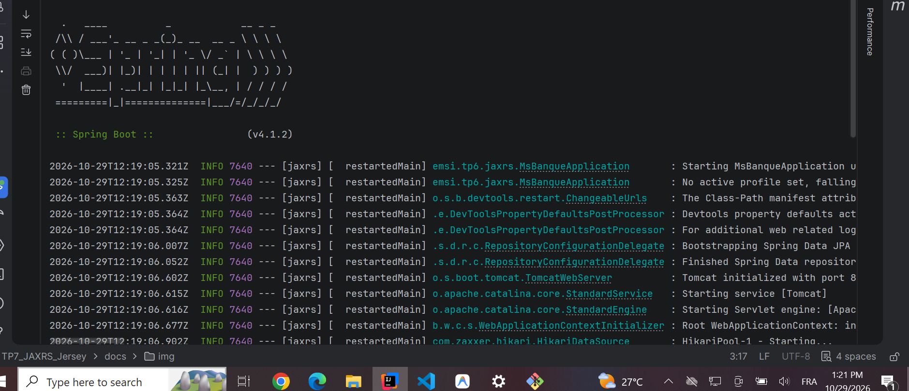
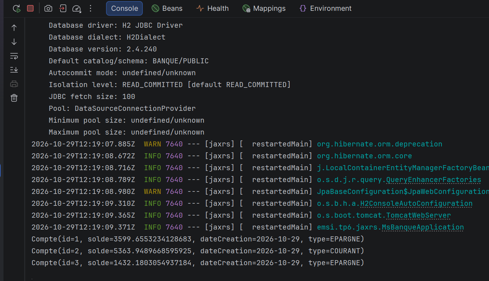
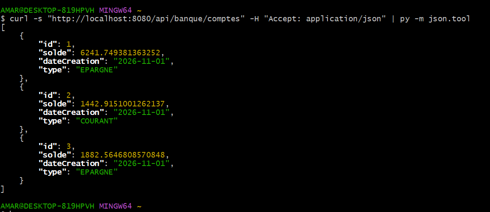
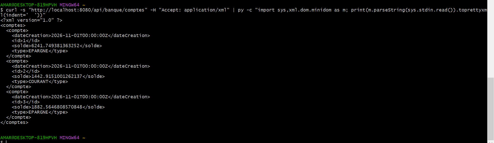

# TP7 – API REST bancaire avec JAX-RS (Jersey) et Spring Boot

Micro-service REST de gestion de comptes bancaires, développé dans le cadre du module **JEE Microservice** (EMSI).
L'API est exposée avec **JAX-RS (Jersey)**, intégrée à **Spring Boot**, et persiste les données avec **Spring Data JPA** sur une base **H2** en mémoire.
Les ressources sont disponibles en **JSON** et en **XML**.

## Sommaire

- [Technologies](#technologies)
- [Structure du projet](#structure-du-projet)
- [Modèle de données](#modèle-de-données)
- [Lancer le projet](#lancer-le-projet)
- [Endpoints](#endpoints)
- [Tester l'API avec curl](#tester-lapi-avec-curl)
- [Captures d'écran](#captures-décran)

## Technologies

| Outil | Version |
|---|---|
| Java | 21 |
| Spring Boot | 4.1.2 |
| Jersey (JAX-RS) | 4.0.3 |
| Spring Data JPA / Hibernate | 7.4 |
| Base de données | H2 (en mémoire) |
| JAXB (sérialisation XML) | `jakarta.xml.bind` + `jaxb-runtime` |
| Lombok | `@Data`, `@NoArgsConstructor`, `@AllArgsConstructor` |
| Swagger (annotations JAX-RS) | `swagger-jaxrs2-jakarta` |
| Build | Maven (wrapper inclus) |

## Structure du projet

```
TP7_JAXRS_Jersey
├── docs/img/                      # Captures d'écran
├── src/main/java/emsi/tp6/jaxrs
│   ├── MsBanqueApplication.java   # Point d'entrée + données initiales
│   ├── config/MyConfig.java       # Enregistrement de la ressource Jersey
│   ├── controllers/
│   │   └── CompteRestJaxRSAPI.java  # Ressource JAX-RS (CRUD)
│   ├── entities/
│   │   ├── Compte.java            # Entité JPA + @XmlRootElement
│   │   └── TypeCompte.java        # Enum : COURANT, EPARGNE
│   └── repositories/
│       └── CompteRepository.java  # Spring Data JPA
├── src/main/resources/application.properties
└── pom.xml
```

## Modèle de données

Entité `Compte` :

| Champ | Type | Description |
|---|---|---|
| `id` | `Long` | Identifiant généré automatiquement |
| `solde` | `double` | Solde du compte |
| `dateCreation` | `Date` | Date de création (`@Temporal(DATE)`) |
| `type` | `TypeCompte` | `COURANT` ou `EPARGNE` (stocké en `ORDINAL`) |

Au démarrage, `MsBanqueApplication` insère **3 comptes** avec un solde aléatoire (entre 0 et 9000).

## Lancer le projet

**Prérequis :** JDK 21 (Maven n'est pas nécessaire grâce au wrapper).

```bash
# Linux / macOS / Git Bash
./mvnw spring-boot:run

# Windows (CMD / PowerShell)
mvnw.cmd spring-boot:run
```

Ou directement depuis IntelliJ IDEA : exécuter la classe `MsBanqueApplication`.

L'application démarre sur **http://localhost:8080**.

### Configuration (`application.properties`)

```properties
spring.application.name=TP7_JAXRS_Jersey
spring.datasource.url=jdbc:h2:mem:banque
server.port=8080

# Préfixe du servlet Jersey (libère "/" pour Spring MVC et les ressources statiques)
spring.jersey.application-path=/api
```

### Console H2

- URL : http://localhost:8080/h2-console
- JDBC URL : `jdbc:h2:mem:banque`
- Utilisateur : `SA` (mot de passe vide)

## Endpoints

Tous les endpoints sont préfixés par **`/api`**.

| Méthode | URL | Description | Corps |
|---|---|---|---|
| `GET` | `/api/banque/comptes` | Liste de tous les comptes | – |
| `GET` | `/api/banque/comptes/{id}` | Détail d'un compte | – |
| `POST` | `/api/banque/comptes` | Création d'un compte | JSON ou XML |
| `PUT` | `/api/banque/comptes/{id}` | Modification d'un compte | JSON ou XML |
| `DELETE` | `/api/banque/comptes/{id}` | Suppression d'un compte | – |

Formats supportés (`@Produces` / `@Consumes`) : `application/json` et `application/xml`.
Le format de la réponse se choisit avec l'en-tête `Accept`, celui du corps envoyé avec `Content-Type`.

## Tester l'API avec curl

Sans Postman, `curl` suffit. Ajouter `-i` pour voir le code HTTP et les en-têtes.

### Lecture (GET)

```bash
# JSON, affichage lisible
curl -s "http://localhost:8080/api/banque/comptes" -H "Accept: application/json" | py -m json.tool

# XML, affichage lisible
curl -s "http://localhost:8080/api/banque/comptes" -H "Accept: application/xml" \
  | py -c "import sys,xml.dom.minidom as m; print(m.parseString(sys.stdin.read()).toprettyxml(indent='  '))"

# Un seul compte
curl -i "http://localhost:8080/api/banque/comptes/1" -H "Accept: application/json"
```

> Sous Linux/macOS, remplacer `py` par `python3`. Si `jq` ou `xmllint` sont installés, on peut les utiliser à la place.

### Création (POST)

```bash
# Corps JSON
curl -i -X POST "http://localhost:8080/api/banque/comptes" \
  -H "Content-Type: application/json" -H "Accept: application/json" \
  -d '{"solde":5000,"dateCreation":"2026-11-02","type":"COURANT"}'

# Corps XML
curl -i -X POST "http://localhost:8080/api/banque/comptes" \
  -H "Content-Type: application/xml" -H "Accept: application/xml" \
  -d '<compte><solde>5000</solde><dateCreation>2026-11-02T00:00:00Z</dateCreation><type>COURANT</type></compte>'
```

### Modification (PUT)

```bash
curl -i -X PUT "http://localhost:8080/api/banque/comptes/1" \
  -H "Content-Type: application/json" -H "Accept: application/json" \
  -d '{"solde":7000,"dateCreation":"2026-11-02","type":"EPARGNE"}'
```

### Suppression (DELETE)

```bash
curl -i -X DELETE "http://localhost:8080/api/banque/comptes/1"
```

## Captures d'écran

**Démarrage de l'application**



**Initialisation de la base et comptes créés au démarrage**



**`GET /api/banque/comptes` en JSON**



**`GET /api/banque/comptes` en XML**


